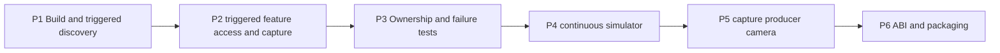

# GenTL consumer v1 implementation plan

Implement [iris.h](inc/iris.h) as a C++ shared library with a C ABI on Linux x86-64. Use EMVA GenApi 3.5.1 for feature access and load CTIs through their GenTL C entry points. Use a small C capture executable and the same public API throughout qualification. Start with triggered mock, repeat the workflow with continuous SDK3 simulator, then use the real camera through Euresys capture producer. The [API review](API_REVIEW.md) records the consumer contracts.

The first release targets one active stream per device, simultaneous acquisition through multiple CTIs in one process and context, complete single-image payloads, caller-driven acquisition, and zero heap allocations on the consumer capture path after start. Qualification is specific to the CTI version, device, firmware, and acquisition configuration exercised. capture producer and capture producer controller sequencing, CBlue partial buffers, multipart and GenDC, and caller-supplied DMA buffers need their own acceptance cases.

## Fixture baselines

- **triggered mock.** Use the CTI's dynamic-geometry mock and a synthetic CLProtocol provider. Pass the fixture paths described in [VERIFICATION.md](VERIFICATION.md#fixtures).
- **continuous SDK3 simulator.** Use a producer build with a matching SDK3 runtime. Keep the runtime location explicit so the same test setup works across build trees.
- **capture producer.** For physical camera qualification, pass the installed `capture producer.cti` path to the Iris capture executable. Record the CTI version, device settings, and results for that configuration.

## Implementation phases

| Phase | Deliverable | Exit evidence |
| --- | --- | --- |
| **P1 Build and triggered discovery** | Add CMake build and install targets for the shared library and header. Use explicit GenTL header and GenApi SDK/runtime paths. Implement status translation, thread-local diagnostics, CTI loading, a process-wide registry keyed by canonical path, device snapshots, exact and serial selectors, and stream open/close. Add a C capture tool with a discovery mode. | triggered mock snapshot identifies one device and reopens it by exact identity. Missing CTI, bad symbol, duplicate serial and stale identity yield distinct errors. Multiple contexts share producer initialization and release it after the last user. Check the public symbol list and ELF dependencies. |
| **P2 triggered feature access and capture** | Implement module node maps, port URL loading and register I/O. Implement typed features, GenApi text conversion, live ranges and enumeration access. Add complete-image capture with a timed wait, immediate try, bounded inline poll, frame metadata and stats. | With the dynamic triggered fixture, change geometry and read back its constraints and payload size. Start, issue software trigger, verify image geometry, PFNC metadata and deterministic bytes, release, then stop and restart. Verify empty try, finite timeout and poll limits through the C ABI. Pass the allocation gate below from the first receive after start. |
| **P3 Ownership and failure tests** | Add a test CTI or test-only dispatch seam for precise failure injection. Complete concurrent stop, rollback, cleanup retries, stale-token rejection and per-stream counters. | Inject failures after announce, queue, stream start and remote start, and during requeue, stop and revoke. Verify each owned handle or buffer remains accounted for. Stop a blocked reader, stop with a held frame, restart after release, close one device while a peer streams, and discover while a peer streams. Run ASan/UBSan and use TSan with the controllable fixture for library-owned state. Test that try and poll return promptly under controlled consumer contention. |
| **P4 continuous simulator** | Run the same C executable and test contracts against the production continuous SDK3 CTI. Cover the SDK3 queued buffer path and device feature constraints. | Confirm simulator identity before acquisition. Check numeric and enumeration access, geometry and payload changes, ordered control, repeated start/stop and frame lifetime under buffer pressure. Run the concurrent producer test below and repeat the allocation gate. Record CTI and SDK3 versions and the fixture command. A simulator pass establishes software integration with this producer. |
| **P5 capture producer camera** | Run the Iris capture executable on a physical camera through the capture producer producer. | Save the qualified configuration, sample frame data, capture statistics, timing measurements, and restart evidence. Record untested configurations separately. |
| **P6 ABI and packaging** | Install the public header and versioned shared library. Keep the interface provisional during development. | In a clean runtime environment, the installed C executable can load the library, discover through an explicit CTI, read a feature and receive and release an triggered frame. Check exported signatures, C and C++ header compatibility and runtime dependencies. |

## Implementation contracts

- **Discovery and lifetime.** Share producer and interface ownership across contexts and devices. Keep snapshots independent of live enumeration and preserve their strings until list close. Resolve exactly one producer and select by stable interface and device IDs or a unique transport serial. Keep active device and stream handles stable across discovery refresh. Resolve GenTL symbols and capture native diagnostics through the dispatch table for the owning CTI. Key interface and device identity within their producer because IDs can repeat across CTIs. Use local loader symbol visibility and keep the process-wide registry lock off the capture path.
- **Feature access.** Resolve XML through standard GenTL port URLs. Start with the forms observed in the fixtures, then verify register-backed XML and ZIP and any local-file form needed for capture producer. Validate returned byte counts. Evaluate access and constraints at call time and exercise selector-driven feature changes. Document cache invalidation behavior before qualifying features that change autonomously.
- **Start and stop.** Query producer alignment, minimum announced buffers and payload after configuration. Start with producer allocation when required and use aligned consumer-owned memory only where accepted by the CTI. Register completion events and queue buffers before starting the stream, coordinate supported `TLParamsLocked`, then issue remote acquisition start in combined mode. Track successful and potentially side-effecting stages. Stop attempts host cleanup even when a remote command fails. Abort the pending wait, synchronize with the reader and handler, flush, then revoke when outstanding frames permit it. A failed cleanup retains ownership for retry. Re-register or clear the event before restart so cancellation cannot leak into a new run.
- **Receive.** Use `EventGetData(..., 0)` for immediate try and bounded poll. One reader owns receive on each stream. An empty try returns `IRIS_NO_FRAME`. An empty poll returns `IRIS_OK` with zero deliveries. Try and poll may return `IRIS_BUSY` when another operation holds the stream lock. An admitted poll holds that lock through a bounded batch, including its producer calls and inline callbacks. Keep callbacks short and free of calls into Iris. A completed buffer returned by explicit receive always carries one release obligation, even if image validation failed. Frame tokens identify the issuing stream and current borrow. Release after stop retires the buffer. A failed requeue consumes the token, retains the buffer for cleanup and makes the stream require recovery.
- **Image and clocks.** Validate image offsets and size against filled bytes and announced capacity. Verify stride, packing and byte order before exposing pixels. Keep producer timestamp and host monotonic dequeue timestamp distinct. Measure call duration as well as capture timing because an immediate event check may still incur producer lock or metadata overhead.

## Concurrent producer qualification

- Open triggered mock and continuous simulator with distinct absolute CTI paths in one context. Use test-specific runtime paths that resolve both producers in the same process. Discover and configure each through its own node map, then start both streams before receiving from either.
- Alternate `try_get_frame` or bounded `poll` on the two streams in one duty cycle. Verify both make progress and that frame geometry and content identify the expected source. Hold one producer's frame while receiving from the other and verify that a cross-stream release is rejected without consuming the borrow. Repeat with a reader per stream and run the acquisition allocation gate with both active.
- Stop and close one producer's last device while the other stream is active. Verify the remaining stream still delivers frames, then reopen and restart the first producer. Reverse the order. Exercise discovery during acquisition and a failed load of a third CTI while both streams are active.
- At the bench, repeat mixed-producer capture with capture producer and triggered mock in the same process. Record the actual CTI and runtime versions. This checks coexistence with the capture producer deployment and qualifies one physical camera.

## GenICam usage

The C capture tool should demonstrate the normal SDK sequence. Discover a producer's devices, open the device, configure its remote node map, open a data stream, start acquisition, retrieve a completed buffer, release it back to the input queue, and stop. Use SFNC names and symbolic enumeration values directly. For example, a software-triggered setup selects `TriggerSelector`, sets `TriggerSource=Software` and `TriggerMode=On` where available, and executes `TriggerSoftware` after start.

Keep the stream and remote device distinct, and expose their node maps separately. Start handles buffer allocation, announce and queue for the default pool. `wait_frame` and `try_get_frame` both dequeue one completed buffer. `release_frame` requeues it while acquisition is running. Use `poll` to consume a bounded batch inline.

## Acquisition allocation gate

The consumer budget is **zero heap allocations from the first receive after successful start**. Exercise `iris_stream_try_get_frame`, `iris_stream_wait_frame`, `iris_stream_poll`, and `iris_stream_release_frame` on an active stream. Cover a successful borrow and requeue, empty queue, timeout, incomplete or rejected image, and empty and full poll batches. Repeat from the first receive after restart. Discovery, feature access, setup, teardown, and exceptional recovery may allocate.

Allocate pool records, token bookkeeping, event and metadata scratch, and any diagnostic storage before starting acquisition. Use caller-owned frame descriptors and bounded bookkeeping tied to the announced pool. Keep GenApi queries, heap-backed logging, string formatting and container growth out of receive and requeue. The reader owns the receive scratch and lends the producer's image bytes until release. Protect buffer ownership transitions and stream statistics with the stream lock. Keep borrow records alive through concurrent stop.

Run a release-build C harness with fixed-size results and an allocation-free callback. Instrument heap allocation entry points, including aligned allocation and C++ allocation paths, and verify the instrumentation with a known allocation. Attribute calls by origin, including native worker threads, and report consumer and CTI counts and bytes separately. If attribution or interception is incomplete, record the coverage gap. Apply the zero-allocation gate to the consumer. Report allocations observed elsewhere in the process as deployment measurements. Attribute them to a particular producer or runtime only when the evidence identifies the caller. Record first-use behavior separately from steady state.

## capture producer bench run

1. Record camera model, serial, firmware, NIC/link settings, CTI path and version, OS, CPU affinity where relevant, and baseline SDK version. Confirm the camera is available for exclusive bench use. Save the original settings and restore them after the test. Start with the camera's known working complete-frame settings.
2. Discover and reopen the exact camera. Capture in free-run with a common PFNC format, then at a representative ROI and frame rate. Verify feature readback and image extent. Exercise software or external triggering where available and record unsupported cases. Where the camera has a test pattern, compare image bytes. Otherwise verify dimensions, stride, sample values and packing using suitable scene data.
3. Exercise finite timeout, stop while waiting, hold/release after stop, and stop/start cycles. Record a sustained run at the intended operating rate. Track frame IDs, incomplete images, consumer errors and producer counters where available. Run the allocation gate and report consumer and producer observations. Verify that a one-camera bench run leaves multi-camera hardware qualification pending.
4. Measure receive latency and jitter with a consistent clock and observation point across runs. Report host dequeue intervals and call latency distributions with sample counts. Measure trigger-to-host latency only if the trigger and host observations have a common or calibrated clock. Agree on the operating rate, run duration, and latency/drop limits before making a production performance claim. Fail functional qualification for image corruption, ownership violations, deadlocks, or unexplained failures at a previously qualified configuration.

## Follow-through

The Julia wrapper is a later task.
